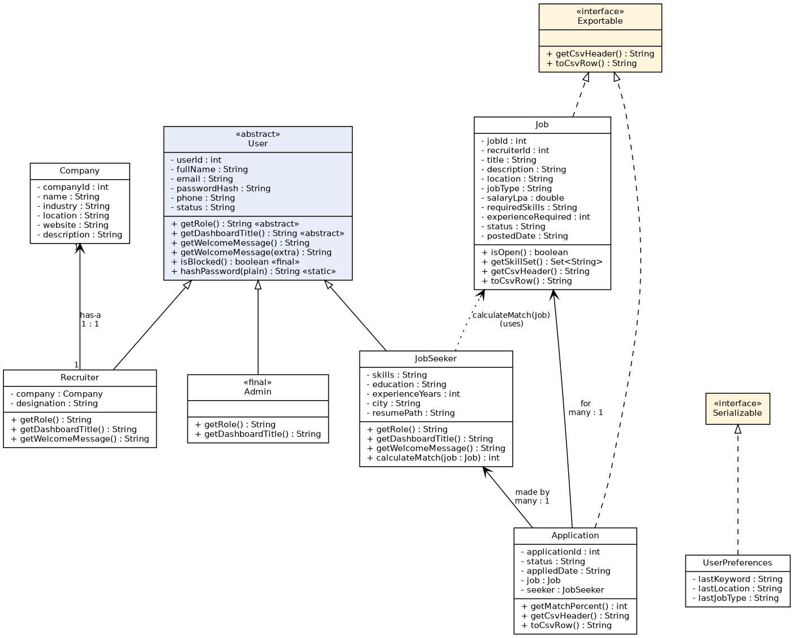
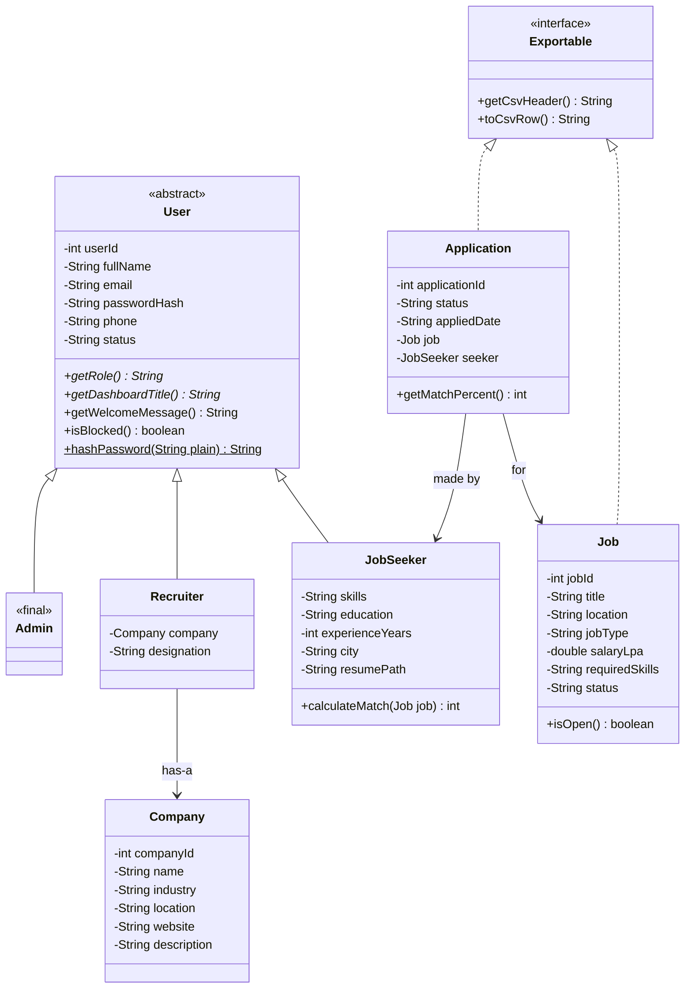
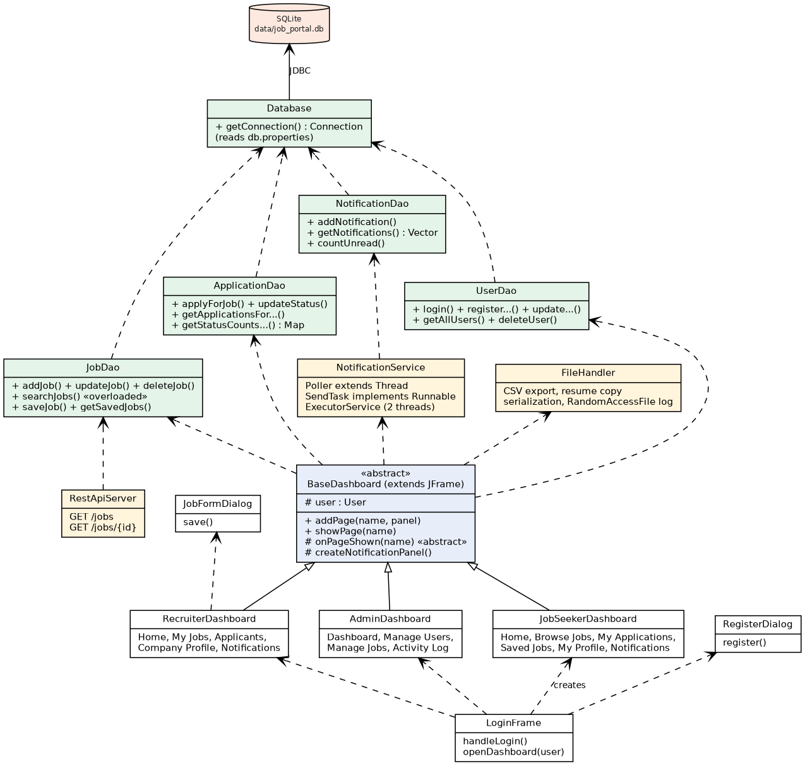
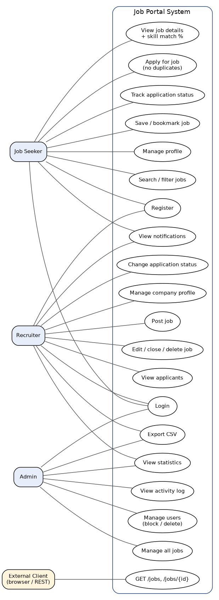
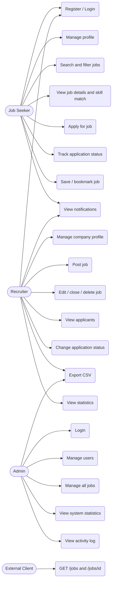
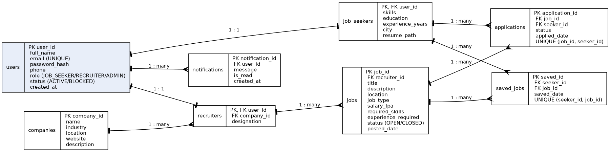
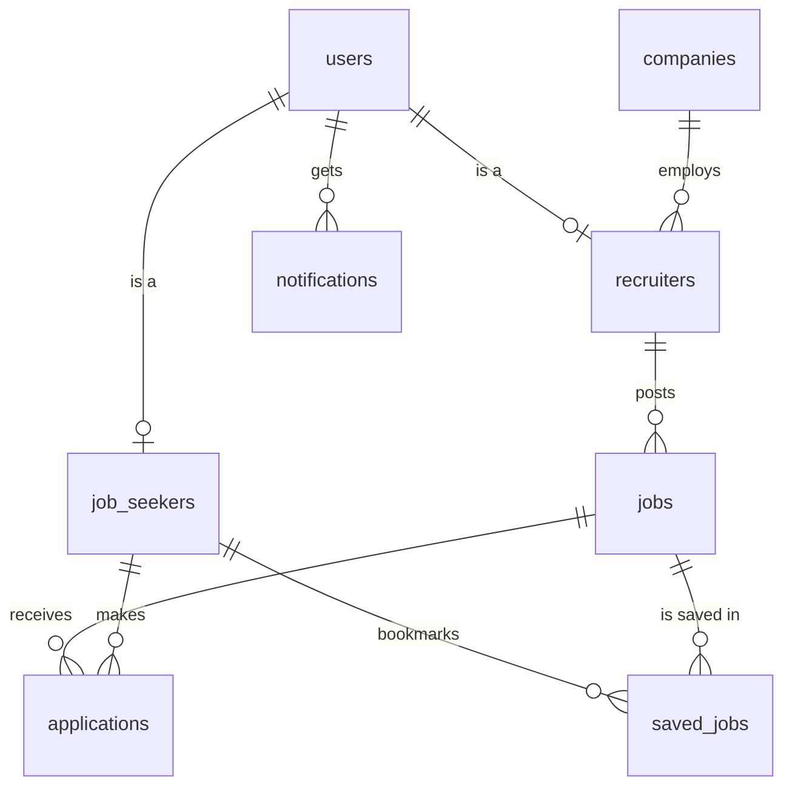

# UML Diagrams – Job Portal System

Ready-made images are in the `docs/` folder. Editable Mermaid versions are given below each image
(they render automatically on GitHub, or paste them into https://mermaid.live).

---

## 1. Class Diagram (model / OOP structure)

---

## 2. Architecture / Layer Diagram (UI → DAO → Database)

Package summary:

| Package | Purpose |
|---|---|
| `jobportal` | `MainApp` – starting point |
| `jobportal.model` | Data classes (User hierarchy, Job, Application, Company …) |
| `jobportal.dao` | JDBC code – every SQL statement lives here |
| `jobportal.service` | Threads (`NotificationService`) and REST API (`RestApiServer`) |
| `jobportal.ui` | All Swing screens |
| `jobportal.util` | Validation (regex), text helpers, file handling |
| `jobportal.exception` | Our own exceptions |

---

## 3. Use Case Diagram

---

## 4. ER Diagram (database)

